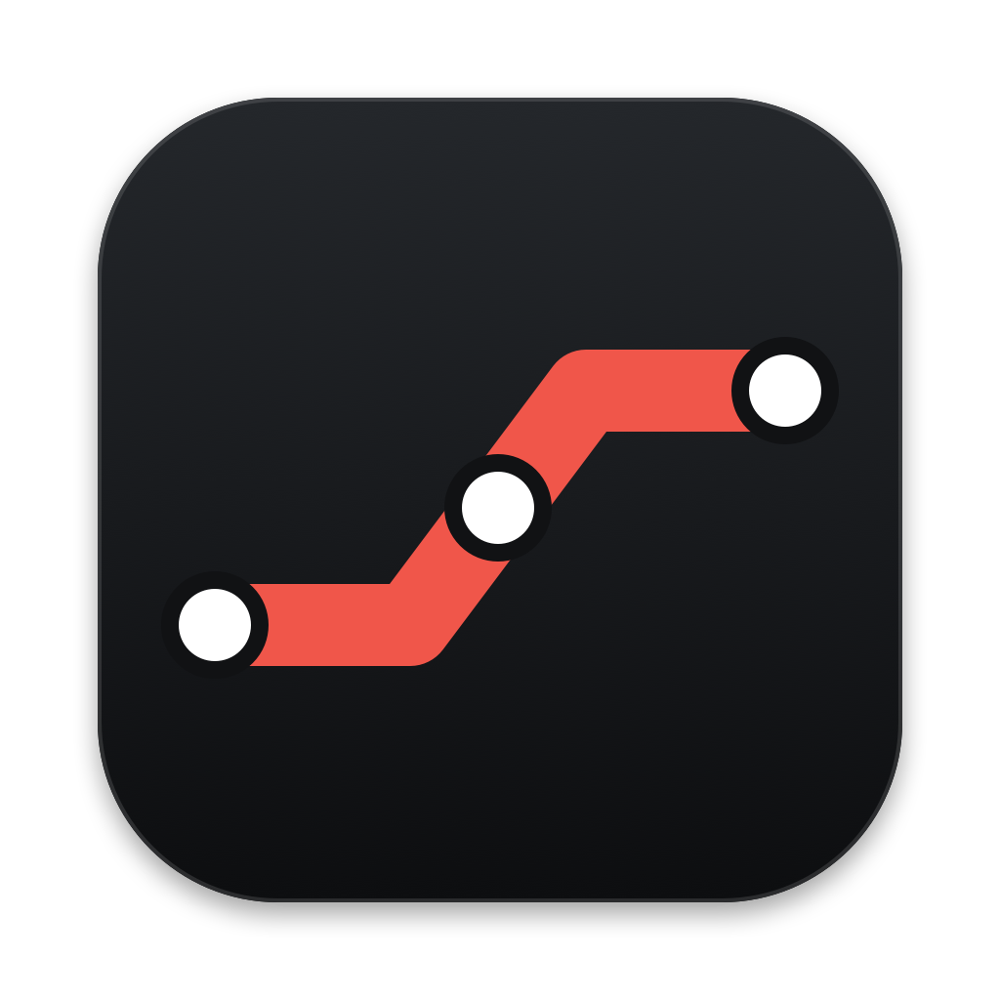

<p align="center">
  
</p>

<h1 align="center">Runwright</h1>

<p align="center">Set up, register and look after self-hosted CI runners on your Mac, without the terminal.</p>

<p align="center"><a href="https://github.com/krnblds/runwright/releases/latest"><b>Download for macOS</b></a> · GitLab Runner · GitHub Actions</p>

---

## Why

Putting a CI runner on a Mac means a download, a token, a config file, a service and a `PATH` that never quite matches your Terminal's. Then it's a black box: you find out it stopped, or that a job can't find `flutter`, when a pipeline fails.

Runwright is a Mac app that does that setup for you and then shows you what your runners are doing. It lives in the menu bar. Everything is local: no Grafana, no Docker, and no API token kept.

## What it does

- **Register a runner in a few clicks.** Paste the token GitLab or GitHub shows when you create a runner. Runwright installs or downloads the runner, registers it and starts it. The token goes straight to the runner's own tooling; Runwright doesn't keep it.
- **See every runner on the Mac.** Homebrew services, runners with their own binary and `config.toml`, and GitHub Actions runner folders (`~/actions-runner` and its siblings), running or stopped.
- **Start, stop and restart.** As a background service that outlives the app, or inside Runwright with the output in a log. Switch single runners on and off.
- **Live status.** Running jobs and their current step, slots in use, failures, job durations and API health, refreshed every few seconds. Watch a job's log live on the runner's page.
- **Missing tools.** Spots tools your Terminal has that jobs can't find, such as `flutter`, `node` or `docker`. One click gives jobs your Terminal's `PATH`.
- **Updates.** Tells you when a newer GitHub Actions runner release is out.
- **Alerts.** Notifies you when a job fails or a runner goes offline.
- **Demo mode** to try it without a runner.

| | GitLab Runner | GitHub Actions |
|---|---|---|
| Install the runner | Homebrew `gitlab-runner` | downloads `actions/runner` |
| Register | runner authentication token (`glrt-…`) from *Settings → CI/CD → Runners → New project runner* | token from *Settings → Actions → Runners → New self-hosted runner* |
| Run | `brew services` or in the app | `svc.sh` (launchd) or `run.sh` in the app |
| Live metrics | metrics endpoint, switched on for you | from the runner's logs |

## Install

[Download the latest DMG](https://github.com/krnblds/runwright/releases/latest), open it and drag Runwright to Applications. Requires macOS 14 or later.

### Build from source

Requires Xcode 16+ (Swift 6).

```sh
scripts/bundle.sh --install   # builds Runwright.app and the DMG, copies the app to /Applications
```

Or run from source with `swift run Runwright`.

The version comes from the `v*` tag on `HEAD` (or `VERSION`).

## Releases

Tagged versions (`v1.2.0`) are on [Releases](https://github.com/krnblds/runwright/releases), as a DMG (open it and drag Runwright to Applications) and a zip.

If macOS blocks the app the first time, open it with right-click → **Open**, or `xattr -dr com.apple.quarantine Runwright.app`.

## How it works

| Reads | For |
|---|---|
| `http://127.0.0.1:9252/metrics` (`listen_address`) | live jobs, counters, histogram |
| `~/.gitlab-runner/config.toml` and other runners' configs | registered runners, executor, `PATH` |
| `brew services`, `ps` | what's running and how |
| GitHub runner folders: `.runner`, `_diag` logs | registered GitHub runners, their jobs and version |
| `launchctl` | GitHub runners installed as a service |

Runwright never reads a runner's credentials. It only changes `config.toml` when you ask it to (turn on live status, use your Terminal's tools). It keeps a `.runwright-backup` copy next to the file each time.

## Project layout

```
Sources/SlateDesign            Command Slate design system in SwiftUI (Carbon theme)
Sources/RunwrightCore          shared, provider-neutral pieces: processes, Terminal tools,
                               events, and the RunnerProvider protocol with RunnerSummary
Sources/RunwrightGitLab        gitlab-runner: metrics parser, models, store, runner control,
                               and GitLabProvider
Sources/RunwrightGitHub        GitHub Actions self-hosted runners: finding runner folders,
                               .runner and _diag log parsing, svc.sh / run.sh control, and
                               GitHubProvider (local only: no GitHub API, no tokens)
Sources/Runwright              the app: menu bar panel, dashboard, settings
Sources/Runwright/Views/GitLab views only GitLab has: metrics charts, setup, runner pages
Sources/Runwright/Views/GitHub views only GitHub has: setup steps, runner page, sidebar section
Tests/RunwrightCoreTests       tests for the shared helpers and combined status
Tests/RunwrightGitLabTests     parser, store, config and provider tests with real fixtures
Tests/RunwrightGitHubTests     .runner, diag log, ps / launchctl, folder and provider tests
scripts                        bundle.sh, make-icon.swift
```

```sh
swift test
```

## Roadmap

- Buildkite runners
- Project and pipeline names via the GitLab API (opt-in token, stored in the Keychain)
- Job history that survives a restart

## Contributing

See [CONTRIBUTING.md](CONTRIBUTING.md). Licensed under [MIT](LICENSE).
